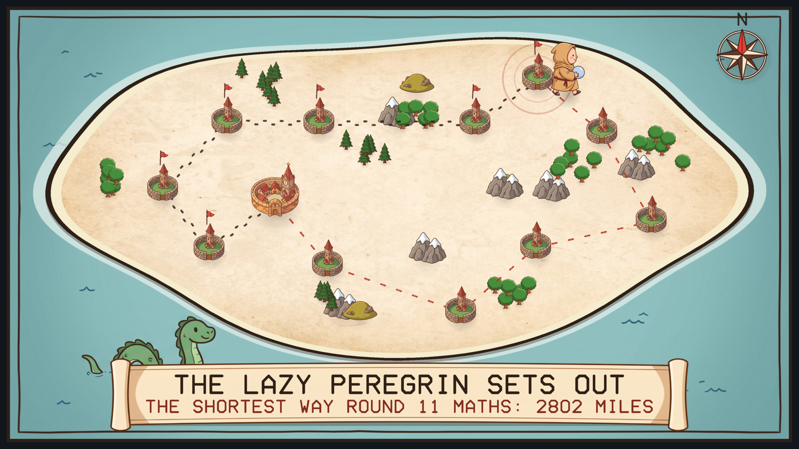
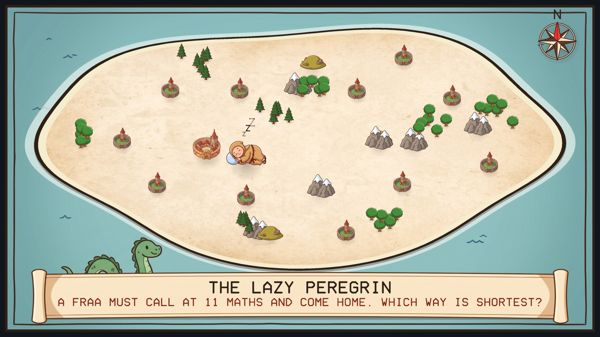
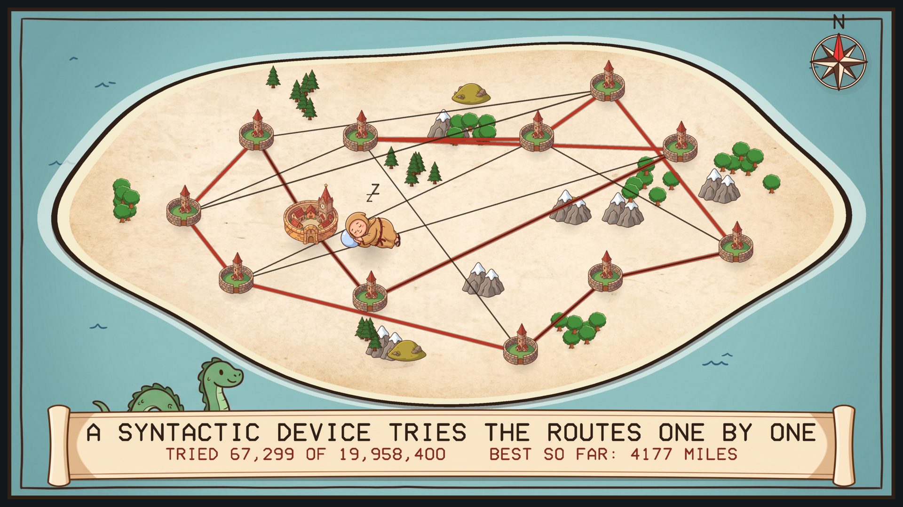
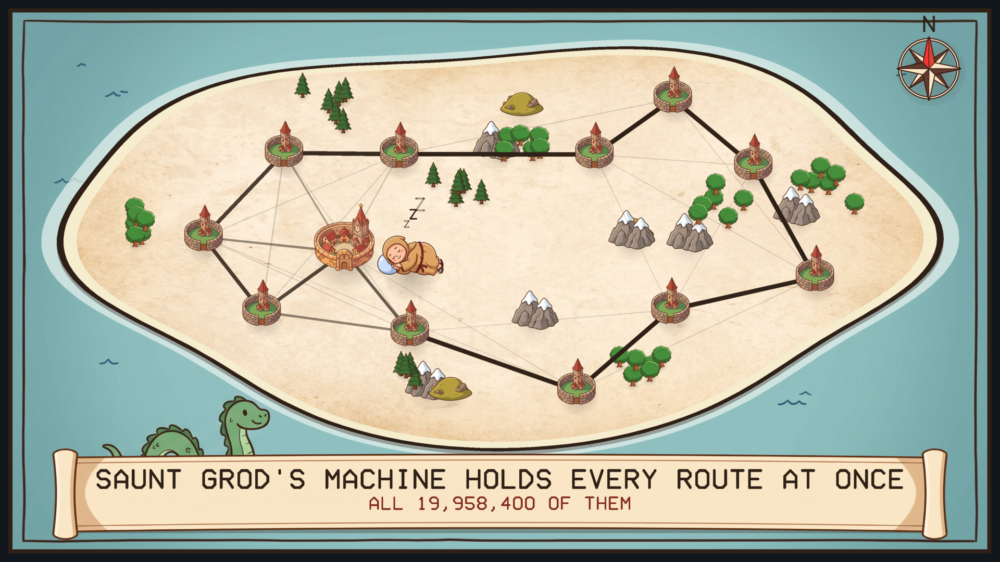
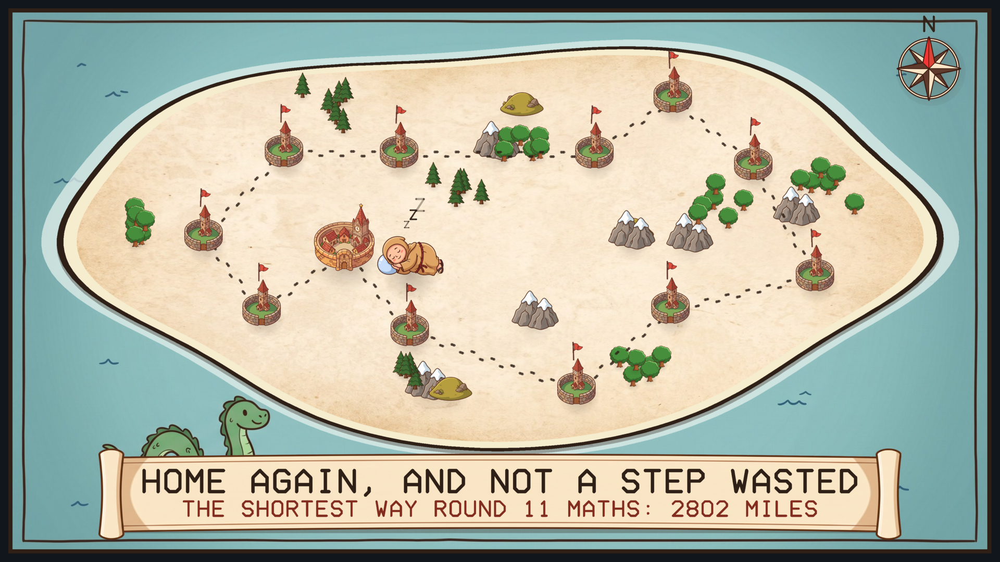

# The Lazy Peregrin

A screensaver for the Lazy Peregrin problem from Neal Stephenson's novel *Anathem*.
Linux, Windows and macOS. One of the [Anathem screensavers](https://github.com/mottipython/anathem-screensavers).

In the book the Lazy Peregrin is the problem of a wandering fraa who must call at a
number of maths and wants to walk as little as possible: Arbre's name for the
travelling salesman problem. A syntactic device has to try the routes one after
another. Saunt Grod's Machines hold every route at once.

## What it shows

Each round is a new island with ten to fifteen maths on it.

1. The fraa is asleep beside his own math, his head on his sphere.
2. A syntactic device tries routes one by one, keeping the best so far. The counter
   shows how many there are to get through.
3. Saunt Grod's Machine holds them all at once, and settles on the shortest.
4. The fraa wakes, picks up his sphere and toddles round. The bells ring him in at
   each math and a pennant goes up. Then he goes home and back to sleep.

| | |
|---|---|
|  |  |
| A fraa, some maths, and a question | The syntactic device at work |
|  |  |
| Saunt Grod's Machine | The shortest route found, and a fraa woken |
|  |  |
| On the road | Home again |

The route he walks really is the shortest. With this few maths an ordinary computer
can find it exactly (the Held-Karp method) in a fraction of a second, and that is
done before each round starts. The picture of Saunt Grod's Machine is a crowd of
160 routes being annealed together, each leg drawn as dark as the share of the
crowd using it. It is a picture of the idea, not quantum computing.

## Install

Packages are on the [releases page](../../releases).

### Windows

Run `LazyPeregrin-Setup-1.0.1.exe`. It asks for administrator rights, because
Windows only lists screensavers that are in its own system folder. After that
"The Lazy Peregrin" is in Screen Saver Settings with the others, already selected.
Uninstall from Apps.

The Windows build is cross-compiled and has been tested on Windows 11.

### macOS

There are two downloads on the releases page, for Apple Silicon and Intel, macOS 11
or later.

**The screen saver** is the file ending `-mac-screensaver.zip`. Unzip it and
double-click the `.saver` file; macOS offers to install it. Then choose it in System
Settings, Screen Saver (scroll to the end of the list, under Other).

**The app** is the file ending `-mac.zip`: the same thing as an ordinary program
that runs full screen until you press a key.

Neither is signed with an Apple developer certificate, so macOS will refuse them at
first. After the refusal, open System Settings, Privacy & Security, scroll down,
and click Open Anyway. If the screen saver still will not load, clear the
quarantine mark in Terminal:

    xattr -dr com.apple.quarantine ~/Library/"Screen Savers"

Both are built on a Mac build machine, where the screen saver is loaded and made to
draw as a test. They have not yet been tried by a person on a real Mac, and screen
savers on recent macOS are known to be temperamental; reports are welcome.

### Linux

**Fedora, Nobara** (built on Fedora 44):

    sudo dnf install ./lazy-peregrin-1.0.1-1.fc44.x86_64.rpm

**Debian, Ubuntu, Mint** (Ubuntu 22.04 / Debian 12 or later):

    sudo apt install ./lazy-peregrin_1.0.1_amd64.deb

That is all: from your next login it starts by itself after five minutes idle, and
any key or mouse movement ends it. To start the watcher without logging out, or to
change the delay:

    lazy-peregrin-screensaver enable 10    # after 10 minutes idle
    lazy-peregrin-screensaver disable
    lazy-peregrin-screensaver status
    lazy-peregrin-screensaver now          # run it right away

Wayland desktops have no screensaver service to plug into, so the package starts a
small idle watcher (`swayidle`) at login. It works on compositors that provide the
ext-idle-notify protocol: KDE Plasma, Sway, Hyprland, niri, COSMIC, labwc and
others. GNOME does not provide it, and on X11 you would add `lazy-peregrin` to
xscreensaver or your desktop's own idle settings. It does not lock the screen. If
[Teglon](https://github.com/mottipython/teglon) is already on screen it stays out
of the way.

## Running it yourself

    lazy-peregrin              full screen on every display; any key or mouse movement quits
    lazy-peregrin --window     in a window; Esc or Q quits
    lazy-peregrin --maths 12   how many maths (6 to 18)
    lazy-peregrin --speed 2    faster
    lazy-peregrin --snapshot out.bmp --time 52 --size 1920x1080

## Building

Needs a C compiler, make and SDL2 (2.0.18 or newer). Build from the top of the
source tree, because the pictures in `assets/art` are built into the program.

    make
    make check
    sudo make install

Packages are written to `dist/`:

    make deb        # needs dpkg-deb
    make rpm        # needs rpmbuild; packs the current git commit
    make installer  # Windows installer; needs mingw-w64, SDL2 for mingw and NSIS

## Credits and licence

MIT. *Anathem* and the Lazy Peregrin are Neal Stephenson's; this is an unofficial
fan project.

The pictures (the fraa, the maths, trees, mountains, compass, scroll, sea and
parchment) were drawn with Google Gemini and prepared by `tools/make_sprites.py`.
Images are decoded with [stb_image](https://github.com/nothings/stb) (public
domain).
